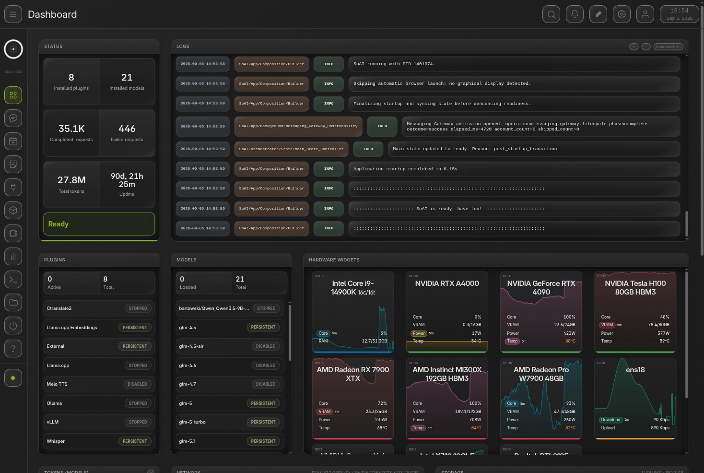
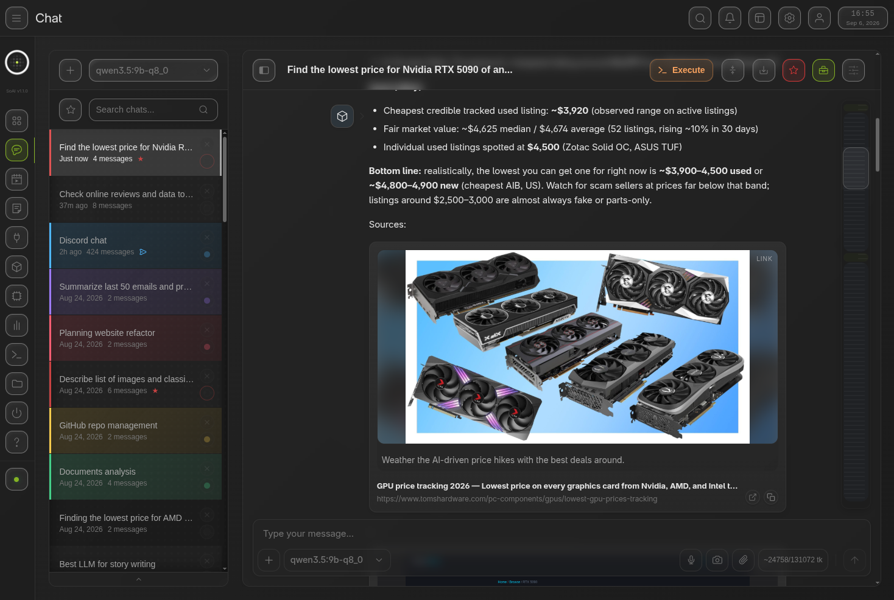
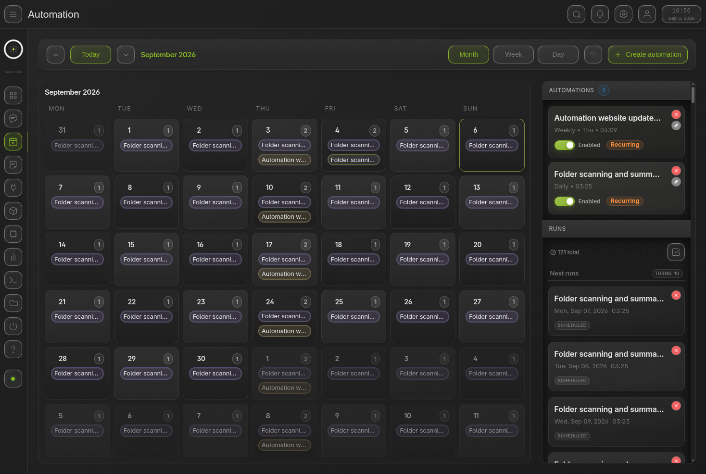
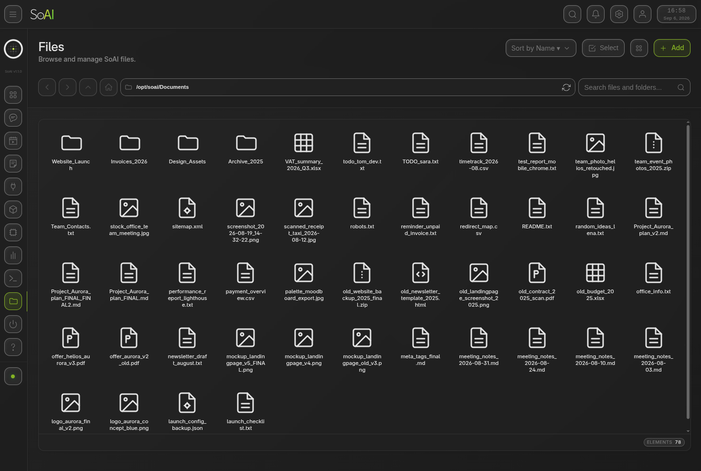
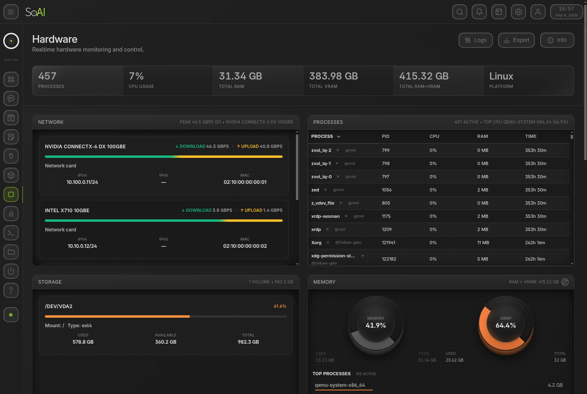

<p align="center">
<picture>
<source media="(prefers-color-scheme: dark)" srcset="media/readme/soai-wordmark-dark.webp">
<source media="(prefers-color-scheme: light)" srcset="media/readme/soai-wordmark-light.webp">

</picture>
</p>

<p align="center"><strong>Smart Orchestrator for Artificial Intelligence</strong></p>

SoAI is a feature-rich agent platform that unifies local inference engines and remote providers behind one resilient orchestration layer. It provides OpenAI-compatible and Anthropic-compatible client APIs and a complete WebUI with chat, tools, automations, file management, hardware control, and a RAG knowledge base.

<p align="center">
<a href="https://soai.to/#download"></a>
<a href="https://soai.to/documentation/"></a>
</p>
<p align="center">
<a href="https://github.com/GetSoAI/SoAI"></a>


<a href="LICENSE.md"></a>
</p>



## What SoAI solves

Local backends (llama.cpp, Ollama, vLLM) and remote providers bring separate APIs and model names, while local engines also need installation, updates, and process management. Switching can require client reconfiguration and downtime; crashes can interrupt requests.

SoAI installs local backends in one click and exposes every configured model through OpenAI-compatible and Anthropic-compatible APIs. Configure OpenAI clients (Open WebUI, LibreChat, Codex, Cursor), Anthropic clients (Claude Code), or custom scripts once. SoAI routes requests, starts and stops local backends on demand, queues work to prevent overload, and retries or reroutes on failure. Virtual models provide load balancing and failover across backends and providers.

SoAI also works on its own: its WebUI supports multiple users and devices, with chat, agents, and everyday model work synchronized in real time, plus hardware monitoring, benchmarking, and GPU control. It combines a breadth of capabilities rarely found in a single AI platform, replacing an entire collection of separate tools.



The UI ships in 22 languages:

🇿🇦 Afrikaans, 🇸🇦 Arabic, 🇨🇳 Chinese (Simplified), 🇹🇼 Chinese (Traditional), 🇳🇱 Dutch, 🇬🇧 English, 🇫🇷 French, 🇩🇪 German, 🇮🇳 Hindi, 🇮🇩 Indonesian, 🇮🇹 Italian, 🇯🇵 Japanese, 🇰🇷 Korean, 🇮🇷 Persian, 🇵🇱 Polish, 🇵🇹 Portuguese, 🇷🇺 Russian, 🇪🇸 Spanish, 🇹🇭 Thai, 🇹🇷 Turkish, 🇺🇦 Ukrainian, and 🇻🇳 Vietnamese.

## Install SoAI

The Linux and macOS archives support x64 and ARM64 hosts, and Windows provides an x64 installer and an x64 compressed archive with the compiled native launcher. Your models and inference plugins determine the hardware requirements, and each plugin and model sets its own platform, GPU, memory, storage, and driver requirements.

### Linux

```bash
curl -fsSL https://soai.to/install/linux | bash
```

<details>
<summary><strong>Linux service setup and installation from an archive</strong></summary>

To request service installation and automatic startup during unattended installation:

```bash
curl -fsSL https://soai.to/install/linux | SOAI_INSTALL_AUTOSTART=y bash
```

From an extracted Linux release:

```bash
./install-soai-from-release.sh --target /path/to/soai
```

On supported Debian and Ubuntu systems, `--fast` installs required `apt` packages and configures systemd. This path requires root privileges:

```bash
./install-soai-from-release.sh --fast
```

</details>

### Windows

Run the following in PowerShell:

```powershell
Set-ExecutionPolicy Bypass -Scope Process -Force; irm https://soai.to/install/windows | iex
```

<details>
<summary><strong>Windows installer and archive options</strong></summary>

The Windows release is also available as `SoAI-<version>-windows-x64-setup.exe` and `SoAI-<version>-windows-x64-complete.zip` in the Releases section of the [SoAI project](https://github.com/GetSoAI/SoAI). The setup executable is the standard install and update path. To use the complete archive, verify it, extract it, and run `install-soai-from-release.bat --target C:\path\to\SoAI` from the extracted `SoAI` folder.

</details>

### macOS (experimental)

```bash
curl -fsSL https://soai.to/install/mac | bash
```

Run `./install_soai_macos.command` from a complete local source tree, or `./install-soai-macos.command` from an extracted macOS release.

Source trees use underscore filenames, including `install_soai_from_release.sh` and `install_soai_from_release.bat`. Complete release archives retain the hyphenated installer names. Installation and successful updates normalize the installed filenames to underscores.

### First run

1. Start SoAI
2. Complete the setup wizard
3. Install new inference engines from the Plugins page or add new models using the Models page

<details>
<summary><strong>Launch commands, service control, and account recovery</strong></summary>

Use the launcher for your installation:

```text
Linux:   soai (or ./soai.sh from the installation directory)
macOS:   ./soai.sh or ./soai.command
Windows: soai.exe (double-click the SoAI icon on the Desktop)
```

The Linux installer adds `soai` to the system command path, so you can run it from any directory. Running the launcher without a command starts SoAI. The commands most users need are `status`, `stop`, and `restart`. The `install-deps` command repairs the managed dependencies. Linux and macOS also support `--start-no-browser` for headless use and `--reset-user-password USERNAME` for account recovery, while `--help` gives the complete command reference. The WebUI and API use port `5090` by default, over either HTTP (the default) or HTTPS depending on your settings. To change the workspace directory of your current SoAI user, use the Settings page.

</details>

## WebUI and agents

Chat with agents and manage models, backends, files, knowledge, terminals, prompts, and automations from one WebUI. Automations run agent tasks in the background, once or on a recurring schedule. Settings cover mail, calendar, messaging, users, permissions, backups, and system configuration. Monitor requests, queues, plugins, hardware, and network activity live. Each account sees only authorized pages and actions, with saved preferences and layouts. Chat, logs, terminals, and hardware can open in separate windows. Split view displays up to three panes side by side when space permits.

### Conversations

Use Chat for replies, Plan to prepare and track steps, and Execute to act through enabled tools. Follow plans, tool calls, arguments, results, code changes, media, and subagent activity live in the transcript. Require approval for protected tools, answer agent questions, queue messages, steer work, or stop a run. Export conversations as JSON or styled PDFs, including model details, attachments, tool activity, compactions, and comparison variants.

<details>
<summary><strong>Conversation settings, history, attachments, and voice</strong></summary>

Conversations retain their model, system prompt, generation settings, tools, workspace, knowledge, voice, and display preferences. Switch models between turns, compare answers to the same prompt, and reuse settings through presets. Search, rename, color, favorite, archive, or create independent clones of conversations. Editing an earlier message or regenerating a reply removes subsequent turns. Drafts sync across devices while preserving local text during conflicts. Full history stays visible beyond the model’s active context; manual or automatic compaction summarizes older messages.

Attach files or folders to a message, or index larger collections as knowledge for retrieval throughout the conversation. Upload from your device, browse workspace files, paste local file links, or capture documents with a camera. Supported formats include code, office documents, PDFs, images, audio, video, archives, and messaging exports. Configured speech models enable dictation, spoken replies, and hands-free voice calls.

</details>

## Inference and model management

Eight bundled plugins cover inference and remote providers. All support Linux, Windows, and macOS except vLLM, whose limits are noted below.

| Plugin | What it does |
| --- | --- |
| Ollama | Managed local Ollama server and binary downloads, plus Ollama Cloud. |
| llama.cpp | GGUF inference through a managed llama-server. CPU, NVIDIA, AMD, Intel, Vulkan, and Apple Metal. |
| vLLM | High-throughput transformer and GGUF inference. NVIDIA, AMD, and Intel GPUs on Linux; Apple silicon CPU or vLLM-Metal GPU (macOS 15+). No Windows support. |
| cTranslate2 | CPU-only translation with Helsinki-NLP Marian models converted to CTranslate2. |
| Embedding | Dedicated GGUF embeddings; same hardware support as llama.cpp. |
| Whisper | OpenAI Whisper speech-to-text. CPU, NVIDIA, Apple MPS, and Intel XPU. |
| MeloTTS | Multilingual text-to-speech with downloadable language packs. CPU, NVIDIA, and Apple MPS. |
| External | Cloud or local OpenAI-compatible APIs, including OpenRouter, OpenAI, Anthropic, Groq, Together AI, and other SoAI instances. |

<details>
<summary><strong>Model downloads, backend setup, and configuration</strong></summary>

Download supported models from Hugging Face, Ollama, or local storage, choosing available variants and quantizations with size and resource estimates shown before installation. You can also upload model files or use a configured model directory. Install, update, and remove managed local backends from the WebUI, with centrally stored per-model settings and startup options and GPU assignment per plugin.

Supported formats, devices, model options, and startup controls vary by plugin; the Plugins page shows what is available on your machine.

</details>

<details>
<summary><strong>Virtual models and request routing</strong></summary>

A virtual model groups two or more configured models and their serving plugins under one identifier. Routing considers backend availability, queue pressure, and whether the model is already loaded, with transparent failover to another eligible target on failure.

Configured models remain visible in `/v1/models` when their local backends are stopped. Backends start on demand; when `MAX_CONCURRENT_PLUGINS` is reached, an inactive backend is unloaded first to make room.

</details>

### Plugins

Add inference engines and capabilities through third-party plugins while keeping the same API and WebUI. Install from a file or URL and manage plugins in the WebUI, which reports when they cannot run or need attention.

Existing OpenAI-compatible services connect through the External plugin without custom development. To build a new integration, follow the guides in the [documentation](https://soai.to/documentation/).

## Tools, automations, and integrations

### Agent and MCP tools

More than 100 tools support chat and background automations:

- Web search, browser use, screenshots, and downloads
- Files, archives, OCR, document parsing, metadata, and knowledge-base ingestion and retrieval
- Shell commands, interactive terminals, and hardware monitoring and control
- Image generation, speech, audio, and video processing
- Mail, calendar, messaging, and notifications
- Memory, conversation history, subagents, and automations

MCP works in both directions: external clients can access tools through the authenticated `/mcp` server, and assistants can use tools from external streamable HTTP MCP servers.

### Automations



Automations run agent tasks in the background at a chosen local time, once or on hourly, daily, weekly, monthly, or yearly schedules. Each task supports multiple ordered turns, with configurable models, workspaces, generation settings, tools, time limits, and tool approval requirements.

Use the calendar to review past and upcoming runs, edit schedules, enable or disable tasks, remove individual occurrences, or stop queued or active work. Live run details show plans, progress, and result previews. SoAI saves each run as a Chat conversation that remains available after its automation is deleted, with optional completion or failure notifications.

### Files



The Files page provides server workspaces for each account, with administrator-assigned shared folders and read/write permissions. Browse, search, create, and edit files, preview media, and upload files or entire folders (including huge ones) in parallel. Copy, move, download, or delete selections with progress and failure reporting; folder and multi-file downloads use ZIP archives.

Attach stored files or folders through a SoAI link from the Files page, or browse them directly in Chat. Conversations use the workspace originals without creating duplicate copies.

### Mail, calendar, and messaging

Connect mail and calendar accounts in Settings using passwords or OAuth, with connection tests, on-demand sync, and error reporting. Agents can search, read, draft, send, reply to, and organize mail via IMAP/POP3 and SMTP, and save attachments to Files. CalDAV tools manage one-off and recurring events, invitations, and reminders.

Connect Telegram, WhatsApp, or Discord to SoAI. Threads become WebUI conversations, with replies returned through the same service. Each account has its own model, agent settings, workspace, tools, and sender policy, allowing specific sender IDs or anyone who can reach the bot. Incoming files and media become attachments.

### SoAI Connect

[SoAI Connect](https://github.com/GetSoAI/SoAI_Connect) is an MIT-licensed Android client for your SoAI server. Download the APK from the project’s Releases section or [soai.to](https://soai.to). An iOS-compatible version will be released in the future.

## Hardware and operations



### Monitoring and GPU control

The Hardware page monitors CPU, memory, swap, storage, network traffic, processes, and detected GPUs live. Available GPU readings include core/VRAM use, temperature, power draw and limits, core/memory clocks, and active processes. CPU, GPU, disk, and network history offers configurable charts, device and metric selection, time ranges, aggregation, and CSV export. Supported GPUs also offer overclocking, power-limit, and fan controls.

<details>
<summary><strong>GPU tuning controls and SoAI Bench</strong></summary>

Available power, core/memory clock, fan, and reset controls depend on the GPU, platform, drivers, permissions, and administrator policy. Save and restore three presets per GPU. After an unsafe shutdown, SoAI resets supported tuning controls to defaults.

SoAI Bench assesses GPU inference readiness through standard and stress runs covering compute, matrix operations, memory bandwidth, dispatch latency, and sustained mixed workloads. Runs track utilization, power, temperature, stability, and score variance, with live progress and per-GPU history for review or export. You can also share scores on the [soai.to leaderboard](https://soai.to/soaibench-leaderboard.html).

</details>

### Terminal

The Terminal page opens an interactive Xterm.js shell on the machine running SoAI, directly in the WebUI or in a separate window. It supports any command-line application, can be detached, resizes with the browser window, keeps scrollback for the current session, and lets you change the text size or clear the display.

### Backup and restore

A backup covers the database, configuration, plugin settings, uploaded user data, GPU presets, and more. Restore validates and stages the archive before it replaces active files. From the WebUI you can schedule periodic backups or perform them manually.

## Compatible client APIs

SoAI implements OpenAI-compatible endpoints plus an Anthropic-compatible Messages surface for Claude Code. For inference and media requests, the selected model and plugin determine which operations and fields they support (the user can override any capability).

<details>
<summary><strong>Supported endpoints and client configuration</strong></summary>

| Capability | Endpoint |
| --- | --- |
| Chat completions | `/v1/chat/completions` |
| Responses | `/v1/responses` |
| Anthropic Messages | `/v1/messages` and `/v1/messages/count_tokens` |
| Legacy completions | `/v1/completions` |
| Models | `/v1/models` |
| Embeddings | `/v1/embeddings` |
| Image generation, editing, and variations | `/v1/images/*` |
| Audio transcription, translation, and speech | `/v1/audio/*` |
| Files | `/v1/files/*` |

Connect clients using the base URL, a model or virtual model identifier, and an API key if configured. Claude Code and other Anthropic-compatible clients accept the same SoAI API key through `x-api-key` or a bearer token.

</details>

<details>
<summary><strong>API request examples</strong></summary>

```bash
curl http://127.0.0.1:5090/v1/models
```

Send a chat request with a model identifier returned by `/v1/models`:

```bash
curl http://127.0.0.1:5090/v1/chat/completions \
  -H "Content-Type: application/json" \
  -d '{"model":"YOUR_MODEL_ID","messages":[{"role":"user","content":"Reply with one sentence."}]}'
```

Add `-H "Authorization: Bearer YOUR_API_KEY"` if you configured API keys.

</details>

<details>
<summary><strong>REST, streaming, WebSocket, and MCP protocols</strong></summary>

SoAI keeps these protocol surfaces separate. Client requests to `/v1/*` use REST, where chat and legacy completion streams use OpenAI SSE and Anthropic Messages streams use Anthropic named SSE events. WebUI and administration requests to `/api/v1/*` also use REST. The WebSocket at `/api/v1/system/ws` carries live events, snapshots, and interactive sessions. MCP requests to `/mcp` use streamable HTTP and require a personal access token.

</details>

### Authentication and quotas

Until you create the first user, SoAI blocks `/v1/*`, MCP, and protected `/api/v1/*` routes, leaving open the setup wizard, health checks, static UI assets, and the public information routes needed for setup. After setup, users sign in to the WebUI with session authentication, and `/v1/*` handles API keys as follows:

- With no configured keys, the API accepts requests without a bearer token
- Creating the first key makes a valid bearer token mandatory
- Revoking a key disables it and leaves key authentication on
- Deleting all keys opens the API again

Create a key before you make an instance reachable beyond loopback or a trusted private network, because until the first key exists anyone who can reach the port can use `/v1/*`. SoAI stores keys as salted HMAC hashes and shows the plaintext once, at creation. A key can carry an expiration date, a rotation reminder, and hourly, daily, weekly, and monthly request or token quotas, and selected routes can also be throttled by client IP. MCP always requires authentication through personal access tokens that each user creates in the WebUI.

### Coding agents

A coding agent or harness can be used with SoAI in three ways:

| Route | What the agent gets |
| --- | --- |
| `/v1` API | SoAI's routed models through compatible client APIs. |
| `/mcp` server | SoAI's tools, resources, and prompts over streamable HTTP. The agent keeps its own model. |
| WebUI terminal | A shell on the SoAI host through an interactive PTY. The agent keeps its own model and provider configuration. |

Configure any client that accepts a custom OpenAI-compatible or Anthropic-compatible endpoint with the SoAI server address, a SoAI model or virtual model identifier, and a SoAI API key. Requests through either format use the same model resolution, capability validation, queueing, quotas, routing, failover, token accounting, and cancellation flow. A client can also connect to `/mcp` for tools, resources, and prompts, separately or alongside the model API. The [documentation](https://soai.to/documentation/) includes connection instructions and setup guides for supported coding agents and other compatible clients.

## Scheduling and resilience

### Queues and concurrency

SoAI manages inference capacity in layers. It orders waiting requests, limits how much work each user or background workload may run, limits how many local backends run at once, and gives each plugin its own bounded queue, with queue size, per-plugin concurrency, request timeouts, and inactivity-based unloading as separate controls. Plugins can also report whether their backend handles one request at a time or several in parallel. Controlled testing showed that SoAI stays available and usable through bursts of thousands of simultaneous requests across one or multiple plugins, and longer timeouts let more queued requests complete.

The scheduler deduplicates exact requests, so matching in-flight requests share one inference run. It retries transient failures and server errors that the retry policy marks safe, within a bounded attempt count, honors `Retry-After` on rate-limited remote responses, cancels work when a client disconnects if the configuration enables that and the selected plugin supports it, and keeps durable records that SoAI reconciles after a process restart.

### Health monitoring

<details>
<summary><strong>Guardian recovery, quarantine, and circuit breakers</strong></summary>

The Plugin Guardian watches plugin and runtime health. It's configurable and detects hung inference and health-ping failures, then inspects runtime state for persistent errors, stuck transitions, or flapping. Recovery revalidates persistent runtimes in place, and for managed runtimes it stops the backend and requests model discovery so configured models can start again. Guardian recovery has its own attempt limit, and SoAI quarantines a plugin and trips its circuit breaker when those attempts are exhausted or recovery times out. For local inference plugins, the breaker also counts health-affecting request failures within a configurable window: reaching the threshold blocks new dispatch, and after the cooldown a half-open state admits one probe that either closes the circuit or opens it again. The Plugins page reports both states and lets you reset the circuit after correcting the cause.

</details>

### Disk protection

SoAI always checks available storage before supported operations start writing, reserving the expected capacity when the total size is known and each chunk as it arrives when it is not. Space claimed by active jobs counts against what remains, so concurrent operations cannot rely on the same free capacity, and a configurable safety margin is always kept back. Operations that do not fit return a disk-space error, and reservations left by ended processes stop counting at the next check. This covers downloads, uploads, file operations, backup and restore, archive extraction, browser and media output, and knowledge-base storage.

### Offline mode

Offline mode limits SoAI network access to loopback, private, and link-local addresses. The WebUI remains available over your local network and installed backends can continue to run local inference, while requests to public providers and websites return an offline-mode error. SoAI disables model downloads, backend installation, software updates, and mail and calendar synchronization while offline.

## SoAI OS

SoAI OS is a full-featured appliance edition built on SoAI Core. Its custom UEFI image, based on Debian 13 KDE, supports AMD64 and ARM64 and includes installation, encrypted deployment, recovery, and hardware checks. SoAI OS will be released in the future.

## System requirements

SoAI works on CPU-only machines and on machines with one or more GPUs. A GPU is optional, but it is recommended for reasonable local inference speeds.

| Resource | Minimum | Recommended |
| --- | --- | --- |
| CPU | Intel Core i5-2500 or AMD FX-6100 (64-bit CPU with AVX support) | Intel Core i7-6700 or AMD Ryzen 5 1600 |
| RAM | 4 GB DDR3 | 16 GB DDR4 |
| Storage | 128 GB SATA SSD | 512 GB NVMe SSD |
| GPU | Optional.<br>**NVIDIA:** Compatible Pascal-generation GeForce GTX 10-series, Quadro P-series, or Tesla P-series cards.<br>**AMD:** A GPU supported by the selected ROCm or Vulkan runtime.<br>**Intel:** A GPU supported by the selected XPU, SYCL, OpenVINO, Vulkan, or OpenCL runtime. | **NVIDIA:** Compatible Ampere-generation GeForce RTX 30-series, RTX A-series, or Ampere data-center cards.<br>**AMD:** Radeon RX 6000/7000-series or Instinct MI200/MI300-series GPUs.<br>**Intel:** Arc A-series/B-series or Data Center GPU Max cards. |
| Operating system | Debian 12 or 13<br>Ubuntu 24.x or 26.x<br>Windows 10 or 11<br>macOS on Intel or Apple silicon | Same supported operating systems |

The RAM, VRAM, and storage needed for inference depend on the models, quantization, context length, and plugins you use rather than on SoAI alone. Larger models and concurrent requests need more memory, and model files, plugin backends, databases, user files, and working space require storage beyond the application itself.

SoAI can run from HDDs, SD cards, or USB drives, but these do not meet the SSD storage tiers. Lower throughput, higher latency, and removable-media risks can affect model loading, databases, indexing, updates, backups, and concurrent file operations. Use an enterprise SSD for heavy workloads.

SoAI detects and monitors mixed NVIDIA, AMD, and Intel GPUs, routing separate plugin instances or backends to each vendor. CUDA, ROCm, and XPU instances each use their matching vendor’s GPUs; mixed-vendor inference requires separate instances or a runtime supporting the selected devices. Clone plugins to distribute parallel work across one or multiple GPUs.

## Updates and release verification

[Release notes](RELEASE_NOTES.md)

Download these Core files from the Releases section of the [SoAI project](https://github.com/GetSoAI/SoAI):

- Linux archive: `SoAI-<version>-linux-complete.zip` for Linux x64 and ARM64
- macOS archive: `SoAI-<version>-macos-complete.zip` for Intel and Apple silicon
- Windows installer: `SoAI-<version>-windows-x64-setup.exe` for Windows x64
- Windows archive: `SoAI-<version>-windows-x64-complete.zip` with the compiled native launcher for Windows x64
- Primary, macOS, and Windows-archive V1 release manifests, their Ed25519 signatures, and SHA-256 sidecars for the artifacts

## Licensing and privacy

[SoAI Source-Available License 1.0](LICENSE.md) governs SoAI Core.

- Personal Use covers private use by one natural person and use by members and guests of that person's household
- Personal Use is free of charge, requires no paid product key, and sets no deployment limit
- An identified organization can run one deployment for a 30-day internal evaluation under the organization evaluation terms
- Section 3.1 permits review, press, benchmarking, research, and teaching within the limits stated there
- Any commercial use and any organizational use outside the listed exceptions requires a commercial license
- Each covered release also becomes available under the MIT License on its Change Date, exactly four years after its first public distribution

[CHANGE_DATES.md](CHANGE_DATES.md) records the Change Date for each release, and [LICENSE.md](LICENSE.md) reserves the SoAI name and branding. The MIT License covers the bundled plugins and SoAI Connect app, and the SoAI OS image contains its separate terms.

### Current availability

Core Personal Use is available now and free of charge. Commercial licenses, organization evaluations, and SoAI OS are temporarily unavailable; purchases, licenses, appliance media, and credentials are not being issued. This operational restriction does not amend the licenses or change any license grant. Organizations can write to [info@soai.to](mailto:info@soai.to) for licensing information or to join the waitlist for future availability, and [COMMERCIAL_LICENSING_AVAILABILITY.md](COMMERCIAL_LICENSING_AVAILABILITY.md) records the current status.

### Privacy

SoAI does not send prompts, model input or output, uploaded files, credentials, or knowledge-base content to the licensor. It contains no product analytics, telemetry, usage reporting, or crash-reporting software, and local models process request content on the host.

## Security

Send suspected vulnerability reports to [security@soai.to](mailto:security@soai.to) rather than opening a public issue. See [SECURITY.md](SECURITY.md) for supported versions, reporting expectations, and response details.

## Contact

- General enquiries and information: [info@soai.to](mailto:info@soai.to)
- Commercial terms and evaluations: [sales@soai.to](mailto:sales@soai.to)
- Security reports: [security@soai.to](mailto:security@soai.to)
- Privacy, GDPR, and data protection: [privacy@soai.to](mailto:privacy@soai.to)
- Official website: [soai.to](https://soai.to) · Documentation: [soai.to/documentation](https://soai.to/documentation/)

Report bugs through the Issues section of the [SoAI project](https://github.com/GetSoAI/SoAI).
